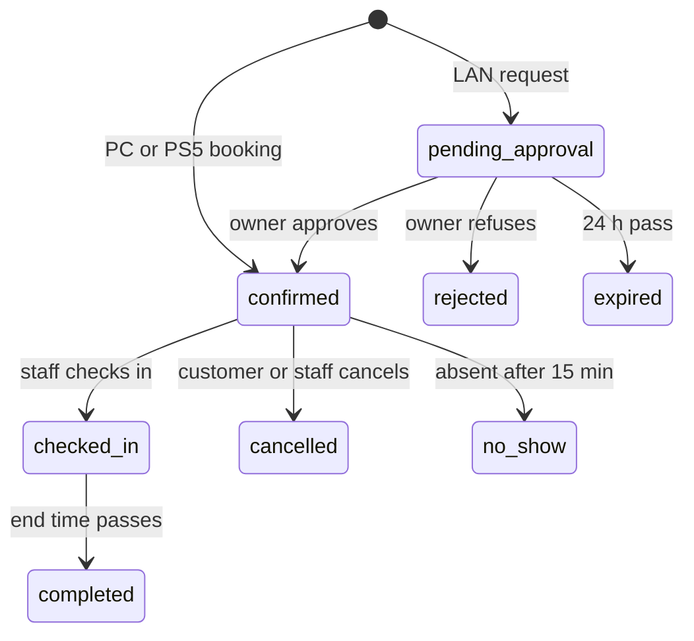

# Respawn Cyber Gaming — Booking & Management System Spec

Nov 15, 2026

## Overview

A web app for Respawn Cyber Gaming (Dar El Beïda, Algiers) where customers book PC stations, the PS5 or the whole venue from live availability, and the owner runs every reservation from one calendar. It replaces WhatsApp and phone bookings, which today produce overlapping reservations.

One rule makes it work: **the system is the only place a reservation exists.** Phone and WhatsApp requests can still come in, but staff enter them in the dashboard before saying yes. If the owner keeps confirming by chat on the side, the app becomes a third channel and the overlaps get worse.

Assumptions used throughout, to confirm with the owner (see Open questions):

- The café is in Algeria: timezone `Africa/Algiers`, prices in DZD, French UI first.
- Open every day from 16:00 to 04:00, per its Google Maps listing. To confirm with the owner.
- 10 PC stations and 1 PS5. Every count is configurable.
- Customers pay at the café, in cash. No online payment in v1.
- Most daily traffic is walk-in; online booking covers planned sessions, groups and LAN events.

## Scope and phases

Build booking first. It alone fixes the overlap problem, and the management features are easier to design after a few weeks of real bookings.

| Phase | What ships |
| --- | --- |
| v1 Booking | Public booking page with live availability, email confirmation, staff dashboard (calendar, manual bookings, LAN approvals), reminders |
| v2 Management | Walk-in session timers and per-station billing, customer history and prepaid hour packs, snack and drink sales, daily cash report, WhatsApp notifications |
| v3 Growth | Tournament and event pages, memberships and loyalty, online deposit for LAN bookings, revenue analytics |

v1 is done when the café runs two weeks with every reservation in the system and zero overlaps.

Out of scope:

- Locking or unlocking the PCs themselves. That needs an agent installed on every machine, which dedicated cybercafé software already does.
- Online payment in v1.
- A native mobile app. The site is mobile-first web.
- More than one venue.

## Users and roles

| Role | Who | Can do |
| --- | --- | --- |
| Customer | Gamers and LAN organisers | Book, view and cancel their own bookings. Logs in with a one-time email code, no password. |
| Staff | Whoever is at the counter | Everything on the daily dashboard: create, move and cancel bookings, check in, mark no-show. No access to settings or prices. |
| Owner | The café owner | Staff rights plus LAN approvals, stations, prices, opening hours, closures, staff accounts, customer blocklist. |

The first owner account is seeded from an `OWNER_EMAIL` environment variable. The owner creates staff accounts from Settings.

## Resources and booking rules

Three things can be booked. A full-venue booking is the only one that needs the owner's approval.

| Resource | Default count | How it is booked | Confirmation |
| --- | --- | --- | --- |
| PC station | 10 | One to five stations per booking. Customers choose how many, not which: the system seats a group on adjacent free stations. Staff can pick specific stations | Instant |
| PS5 | 1 | The console, with the number of players noted | Instant |
| Full venue (LAN) | 1 | Blocks every station and the PS5 for the whole range | Owner approves |

Every value below is a setting, shown with its default:

- **Slots:** 30 minutes. Bookings start on :00 or :30.
- **Duration:** stations 1 to 6 hours. LAN minimum 3 hours.
- **Booking window:** stations from 30 minutes ahead to 14 days ahead. LAN from 48 hours ahead to 60 days ahead.
- **Opening hours:** set per weekday. Closing time can be after midnight; a booking belongs to the business day it starts in.
- **Per-customer limit:** 2 upcoming bookings at a time.
- **Cancellation:** the customer can cancel up to 2 hours before start (LAN: 48 hours). After that, only staff can.
- **Grace period:** a station is held 15 minutes past the start time. Then staff can mark a no-show, which frees the remaining slots.
- **No-shows:** after 3, the customer cannot book online until staff unblock them.
- **Walk-in protection:** each station has a `bookableOnline` flag. Start with half the PCs bookable online and the rest walk-in only. Staff can book any station.
- **Closures:** the owner can block whole business days, up to 62 at a time, for the whole venue or one station (holiday, broken PC). A closure is a `block` booking with its own slot locks, so it cannot be placed over an existing booking.
- **LAN buffer:** 30 minutes blocked after a LAN booking for cleanup.

Conflict rules, enforced by the database and not by the UI:

- A station slot belongs to at most one active booking.
- A LAN request can only be submitted when every station is free for the whole range. While it waits for approval it holds those slots. It expires if the owner does not answer within 24 hours.
- Staff cannot force a booking over another one. They move or cancel the existing booking first. There is no override button, because overrides are the problem being fixed.

## Customer booking flow

A customer goes from the home page to a confirmed booking in under a minute on a phone.

1. Choose what to book: PCs, PS5 or Private LAN.
2. Pick the date, start time and duration. The grid shows only free slots. For PCs, choose how many stations; the system assigns adjacent free ones.
3. Enter name, phone and email. The first time on a device, a 6-digit code sent to that email verifies it. Later visits skip this for 90 days.
4. Review the summary with the estimated price, marked "pay at the café", and confirm.
5. The server locks the slots atomically. If another customer took one a second earlier, the page says which slot was lost and offers the nearest free alternatives.
6. The confirmation screen and an email show the booking code (for example `GC-7K2F`), stations, time, address, a calendar file and a link to view or cancel.

A LAN request uses the same form plus group size and a short description. The customer sees "request received" and gets an email when the owner approves or rejects it.

At the café, the customer gives the code or their name and staff tap Check in.

Booking lifecycle. The first three states hold their slots; the others release them.



PC and PS5 bookings are confirmed at once; only LAN requests pass through approval. Any exit to `rejected`, `expired`, `cancelled` or `no_show` frees the slots for someone else.

## Admin dashboard

The dashboard opens on today's timeline, because that is what the counter needs all day. It must work on a phone and on the counter PC.

| Screen | What it does |
| --- | --- |
| Today | Grid with one row per station and one column per 30-minute slot, a line at the current time, blocks coloured by status. Tap a block to check in, mark no-show, move or cancel. |
| Calendar | The same grid for any day, plus a week overview. A LAN booking shows as one band across all rows. |
| New booking | The same booking engine as the public flow, for any station. Staff tag the source (phone, WhatsApp, walk-in). Customer email is optional here. |
| Requests | LAN requests waiting for approval. Approve or reject with a note and a quoted price. Owner only. |
| Bookings | Search by code, name or phone. Filter by date and status. |
| Customers | Booking count, no-shows, block and unblock. |
| Stations | Add, rename, deactivate; set `bookableOnline` and hourly rate. Owner only. |
| Settings | Opening hours, booking rules, closures, staff accounts. Owner only. The slot size, timezone, currency and language are fixed after launch: existing slot locks depend on them. Email texts live in `messages/fr.json` and are not edited from the dashboard. |

## Notifications

Every change the customer cares about sends one email, in French, from a React Email template.

| Trigger | To | Content |
| --- | --- | --- |
| Email verification | Customer | 6-digit code, valid 10 minutes |
| Booking confirmed | Customer | Code, stations, date and time, price estimate, address, `.ics` file, manage link |
| LAN request received | Customer and owner | Summary; the owner's copy links to the Requests screen |
| LAN approved or rejected | Customer | Decision, quoted price, the owner's note |
| Reminder | Customer | 2 hours before start (LAN: 24 hours) |
| Cancelled or moved | Customer; staff when the customer cancels | Old and new times |
| Daily summary at 09:00 | Owner | Today's bookings and pending requests |

The booking code also appears on screen right after confirming, so a booking never depends on the email arriving. Each send is written to `emailLog` with a de-duplication key, so a reminder is never sent twice.

Email is the v1 channel because it is free and simple. This audience reads WhatsApp far more than email, so WhatsApp confirmations are the first v2 item. All sends go through one `notify(event, booking)` function so a second channel plugs in without touching booking logic.

## Data model

Six MongoDB collections, plus the session and verification collections the auth library creates. All dates are stored in UTC.

```ts
// settings: one document
{ venueName, address, timezone: "Africa/Algiers", currency: "DZD", locale: "fr",
  slotMinutes: 30,
  openingHours: [{ weekday: 0-6, open: "16:00", close: "04:00" }], // close < open = next day
  station: { minMinutes: 60, maxMinutes: 360, minLeadMinutes: 30, maxAdvanceDays: 14,
             cancelCutoffMinutes: 120, maxStationsPerBooking: 5 },
  venue:   { minMinutes: 180, minLeadHours: 48, maxAdvanceDays: 60, cancelCutoffHours: 48,
             approvalTimeoutHours: 24, bufferMinutes: 30 },
  graceMinutes: 15, maxUpcomingPerCustomer: 2, noShowLimit: 3 }

// resources
{ _id, type: "pc" | "console", name: "PC 07", zone?, specs?,
  hourlyRate, bookableOnline: boolean, active: boolean, sortOrder }

// users
{ _id, email /* unique */, name, phone, role: "customer" | "staff" | "owner",
  noShowCount, blocked: boolean, createdAt }

// bookings
{ _id, code /* unique, "GC-7K2F" */,
  type: "station" | "venue" | "block",   // block = closure or maintenance
  resourceIds: ObjectId[],               // venue: every active resource at creation
  start: Date, end: Date,                // aligned to slotMinutes
  status: "pending_approval" | "confirmed" | "checked_in" | "completed"
        | "cancelled" | "rejected" | "expired" | "no_show",
  customer: { userId?, name, phone, email? },  // snapshot at booking time
  partySize?, notes?,
  source: "online" | "phone" | "whatsapp" | "walkin",
  priceEstimate, quotedPrice?,
  manageTokenHash,                       // for the manage link in emails
  history: [{ at, by, from, to, note? }],
  createdBy, createdAt, updatedAt }
// indexes: { code: 1 } unique, { start: 1, end: 1 }, { status: 1, start: 1 },
//          { "customer.userId": 1, start: -1 }, { "customer.email": 1, start: -1 }

// slotLocks: one per resource per slot held by an active booking
{ _id, resourceId, slotStart: Date, bookingId }
// indexes: { resourceId: 1, slotStart: 1 } unique, { bookingId: 1 }

// emailLog
{ _id, bookingId?, to, template, dedupeKey?, status, providerId?, sentAt }
// index: { dedupeKey: 1 } unique, sparse
```

Closures reuse `bookings` with `type: "block"`, so they go through the same lock mechanism as everything else.

## Double-booking prevention

The database refuses overlaps through a unique index on `slotLocks (resourceId, slotStart)`. This is the core of the product and the first thing to build and test.

A check-then-insert approach fails here: two requests can both see the slot as free and both write. With the unique index, the second insert fails and its whole transaction rolls back.

```ts
async function createBooking(input) {
  validateRules(input, settings);              // hours, duration, window, customer limits
  const slots = expandSlots(input.start, input.end, settings.slotMinutes);
  await session.withTransaction(async () => {
    const { insertedId } = await bookings.insertOne(doc, { session });
    await slotLocks.insertMany(
      input.resourceIds.flatMap(r => slots.map(s => ({ resourceId: r, slotStart: s, bookingId: insertedId }))),
      { session }                              // duplicate key (E11000) -> abort -> SLOT_TAKEN
    );
  });
}
```

- **Availability** is read from `slotLocks` only: a slot with no lock is free. It is never computed from overlap queries on `bookings`, so there is one source of truth.
- **LAN booking** inserts locks for every active station and the PS5 across the range plus the cleanup buffer.
- **Statuses that hold locks:** `pending_approval`, `confirmed`, `checked_in`. Moving to `cancelled`, `rejected`, `expired` or `no_show` deletes all of the booking's locks in the same transaction as the status change, so a lock always belongs to a booking that still holds its slots.
- **Moving a booking** deletes the old locks and inserts the new ones in one transaction.
- **Cleanup:** a nightly job deletes locks older than 30 days.
- **Slot size is fixed at 30 minutes** once live. Changing it needs a migration of existing locks.

Required test before any UI work: 50 parallel requests for the same station and slot produce exactly one booking and 49 `SLOT_TAKEN` errors.

## Tech stack and architecture

One Next.js app on Vercel serves the public site, the dashboard and the API. MongoDB Atlas holds the data, Resend sends email, and a Vercel cron job triggers reminders and expiries.

| Layer | Choice | Note |
| --- | --- | --- |
| App | Next.js (App Router), TypeScript strict | Server actions for mutations, route handlers for public API and cron |
| UI | Tailwind CSS, shadcn/ui | Mobile-first |
| Database | MongoDB Atlas free cluster, Mongoose | 0.5 GB storage, 100 operations per second, 3-node replica set, optional daily backups ([limits](https://www.mongodb.com/docs/atlas/reference/free-shared-limitations/)) |
| Auth | Better Auth with its email one-time-code plugin and [MongoDB adapter](https://better-auth.com/docs/adapters/mongo) | No passwords; role stored on `users` |
| Email | Resend, React Email | Free plan: 3,000 emails a month, 100 a day ([pricing](https://resend.com/docs/knowledge-base/what-is-resend-pricing)) |
| Scheduled jobs | Vercel Cron, every 15 minutes | Reminders, request expiry, auto-complete, lock cleanup |
| Validation | zod | On every server input |
| Dates | date-fns, date-fns-tz | Venue timezone from settings |
| i18n | next-intl | French first |
| Tests | Vitest, Playwright | Engine and booking flow |

Two hosting facts to plan for:

- Vercel's free Hobby plan is limited to non-commercial, personal use ([Hobby plan](https://vercel.com/docs/plans/hobby)). A café's booking system is commercial, so production needs the paid Pro plan.
- On Hobby a cron job can run only once per day; Pro allows once per minute ([cron limits](https://vercel.com/docs/cron-jobs/usage-and-pricing)). Two-hour reminders need Pro or an external scheduler calling the cron URL. Vercel's docs also mark Cron Jobs as legacy, to be replaced by Schedules; check which to use at build time.

At three emails per booking (code, confirmation, reminder), Resend's free daily cap covers about 30 bookings a day.

MongoDB works with the lock pattern above. If the database choice is still open, Postgres can enforce no-overlap on time ranges with a built-in exclusion constraint, which removes the lock collection entirely.

Code layout rules for the repo:

- `src/lib/booking/` holds pure functions (slot math, rule validation) with no database access.
- `src/server/booking-service.ts` is the only code that writes `bookings` and `slotLocks`. Pages and actions call it; they never write those collections directly.

```bash
MONGODB_URI=
BETTER_AUTH_SECRET=
RESEND_API_KEY=
EMAIL_FROM="Respawn Cyber Gaming <reservations@example.com>"
APP_URL=
OWNER_EMAIL=
CRON_SECRET=
```

## Routes and API

| Path | Access | Purpose |
| --- | --- | --- |
| `/` | Public | Venue info, prices, hours, Book button |
| `/book` | Public | Booking wizard |
| `/booking/[code]` | Manage token or session | View and cancel a booking |
| `/login` | Public | Email code login |
| `/admin` | Staff | Today grid |
| `/admin/calendar` | Staff | Day and week views |
| `/admin/bookings`, `/admin/bookings/new` | Staff | Search, create |
| `/admin/customers` | Staff | List, block, unblock |
| `/admin/requests` | Owner | LAN approvals |
| `/admin/stations`, `/admin/settings` | Owner | Configuration |
| `GET /api/availability?date=&type=` | Public | Free slots per resource for one business day |
| `POST /api/bookings` | Verified customer | Create a booking or LAN request |
| `POST /api/bookings/[code]/cancel` | Manage token or session | Cancel within the cutoff |
| `POST /api/admin/bookings` | Staff | Create with any source |
| `PATCH /api/admin/bookings/[id]` | Staff; approve and reject owner only | Action: `approve`, `reject`, `check_in`, `no_show`, `move`, `cancel`, `complete` |
| `GET /api/cron/tick` | `CRON_SECRET` | Reminders, expiries, auto-complete, cleanup |
| `/api/auth/[...all]` | Public | Auth library handler |

Errors return a stable code the UI can translate: `SLOT_TAKEN`, `OUTSIDE_HOURS`, `TOO_SOON`, `TOO_FAR`, `LIMIT_REACHED`, `BLOCKED`, `CUTOFF_PASSED`, `INVALID_INPUT`, `INVALID_DURATION`, `TOO_MANY_STATIONS`, `NOT_FOUND`, `INVALID_STATE`, `FORBIDDEN`. The list lives in `src/lib/booking/types.ts`.

## Non-functional requirements

- **Language:** French first. Every string goes through next-intl so Arabic (right-to-left) and English can be added without refactoring.
- **Time:** store UTC, validate and display in the venue timezone from settings. Never rely on server local time.
- **Mobile:** design the customer flow at 360 px width first. The dashboard grid scrolls sideways with the station column pinned.
- **Speed:** availability for one day returns in under 300 ms.
- **Security:** role check on the server for every admin action; zod validation on every input; manage links carry a random token stored hashed; the cron route requires its secret.
- **Rate limits:** 5 code requests per email per hour; 10 booking attempts per IP per 10 minutes.
- **Abuse control:** verified email, the upcoming-bookings limit, the no-show counter and the blocklist.
- **Privacy:** store only name, phone and email. No payment data. The owner can delete a customer, which anonymises their past bookings.
- **Reliability:** a booking succeeds even if its email fails; the failure is logged and shown on the booking in the dashboard. Enable Atlas daily backups.
- **Audit:** every status change is appended to `booking.history` with who and when.

## Build milestones

Eight milestones, one per Claude Code session, each ending with passing tests and a deploy preview. This spec lives in the repo as `docs/SPEC.md`; `CLAUDE.md` points to it and repeats the code layout rules.

1. **Scaffold.** Next.js, TypeScript, Tailwind, shadcn/ui, Mongo connection, env validation, seed script (settings, 10 PCs, 1 PS5, owner account), lint and Vitest in CI. Done when the seed runs against Atlas and the home page deploys.
2. **Booking engine.** Slot math, rule validation, `createBooking`, `cancelBooking`, `moveBooking`, `getAvailability` on slot locks. Done when unit tests pass, including the 50-parallel-requests test and an after-midnight closing time. Confirm here that transactions work on the free cluster.
3. **Auth and email.** Email code login, the three roles, `notify()` with the confirmation template. Done when a real inbox receives a code and a confirmation.
4. **Public booking flow.** `/book` for PCs and PS5, confirmation page, manage link with cancel. Done when Playwright books and cancels at a mobile viewport.
5. **Dashboard.** Today grid, calendar, new booking, bookings list, check-in, no-show, move, cancel. Done when staff can run a full day without the database console.
6. **LAN requests.** Request form, slot hold, approve and reject, 24-hour expiry. Done when a pending request blocks station bookings and an expired one frees them.
7. **Settings.** Opening hours, rules, closures, stations, staff accounts, customers and blocklist. Done when the owner can change every default in this spec without a deploy.
8. **Jobs and launch.** Cron tick, daily summary, French copy review, custom domain and sender domain, existing bookings entered by hand. Done when the café takes its first real booking.

## Open questions for the owner

The answers change defaults, not the design, so the build can start before they are all in.

- [ ] Are the 10 PCs grouped in rooms or zones (a VIP room, for example)?
- [x] Do customers care which PC they get, or only that their seats are together? They don't care: they choose how many seats and the system assigns adjacent stations.
- [ ] What are the opening hours per day? The seed uses 16:00 to 04:00 every day from the Google Maps listing; confirm, including Fridays and Ramadan.
- [ ] Prices: PC per hour, PS5 per hour, LAN privatisation. Any packs or night rates?
- [ ] LAN: minimum hours, deposit, and does it always take the whole venue or sometimes part of it?
- [ ] How many PCs should stay walk-in only at the start?
- [ ] Who runs the dashboard day to day, and on what device?
- [ ] Is 15 minutes the right grace period before a no-show?
- [ ] Languages: French only, or Arabic and English too?
- [ ] Does the café already run timer or billing software on the PCs?
- [ ] Which domain name and sender email address will it use?
- [ ] Will the owner commit to entering every phone and WhatsApp booking in the system?
